# StowSync · 수출 컨테이너 통합 관제

**트럭 도착 예측부터 CY 배치, 유휴시간 선작업, 현장 승인과 결과 공유까지.**

부산항 수출 FCL 컨테이너의 재취급 문제를 주제로 만든 Streamlit 프로토타입입니다. 플래너가 도착 변동과 선적 순서를 함께 확인하고, 예상 이동 횟수와 현장 조건을 비교해 배치를 결정하는 과정을 시연합니다.

> **합성 데이터 기반 기능 데모**입니다. 올컨e·TOS·GPS·기사 이력은 모의 입력이며 실제 시스템 연결, 위치 수집, 메시지 발송, 장비 제어는 수행하지 않습니다. 아래 캡처는 현재 버전 화면이며 기능별 시연 상태를 담아 컨테이너·시각·수치가 서로 다를 수 있습니다.

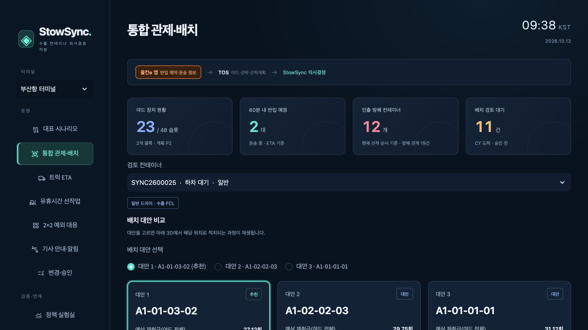

**로컬 실행 주소:** [StowSync 열기](http://127.0.0.1:8501/?page=dashboard) · 서버가 실행 중인 PC에서 접속합니다.

## 처음 방문한 심사위원이 2~3분 동안 누를 순서

앱을 열면 **대표 시나리오** 화면에서 시작합니다. 컨테이너 20개(선박 2척) 가운데 도착이 늦어진 대표 컨테이너 **SYNC2600013**과, 09:49에 같은 A1 블록에서 함께 하차를 기다리는 트럭 3대(A·B·C, 대표는 C)를 다룹니다. 화면 위 **7단계 버튼**과 각 단계 아래 **[← 이전 단계] / [다음 단계 →]**로 이동하고, 각 단계 위에 "확인할 내용 · 할 일 · 결과"가 표시됩니다.

| 단계 | 누를 곳 | 실제로 바뀌는 것 |
|---|---|---|
| 1 상황 확인 | **확인 완료 · CY 도착까지 진행 →** | 운영 시각이 대표 컨테이너의 CY 도착(09:49)까지 흐르고 2단계로 이동 |
| 2 문제 확인 | **다음 단계 →** | 기존 계획 위치(A1-02-02)에 놓으면 먼저 실을 #4를 가로막는다는 설명·3D |
| 3 대안 비교 | 대안 카드의 **이 대안 선택**, **▶ 시뮬레이션 실행**(재생·일시정지·다음·초기화) | 같은 초기 상태에서 대안마다 실제로 실행한 하차 완료까지 작업시간·장비 이동시간·트럭 대기·예상 재취급·기준 대비 절감. 기준안 9.9분, 1안 7.5분(+2.4분). 규칙상 놓을 곳이 없는 순서는 제외 |
| 4 적치 미리보기 | 장치장 **칸(컨테이너) 클릭** | 클릭한 컨테이너가 노랑으로 강조되고 ▼ 화살표가 위치를 가리킴. 오른쪽에 위치·적층 상태·인출 방해 여부, 아래 3D에도 같은 강조 |
| 5 배치 승인 | **✓ 배치 승인** 또는 **보류** | 대기 트럭·장비·야드/계획 버전·유효시간 확인 후 승인 → 장비가 그 순서대로 실행 → 이력 저장 → 6단계로 자동 이동 |
| 6 결과 확인 | — | 실제 적치 위치·완료 시각·절감시간·판단 근거, 3D 재생, 같은 사건을 끝까지 실행한 비교(총 추가 이동 8 → 7) |
| 7 누적 작업 이력 | 표의 **행 클릭**, **↻ 같은 상황에서 새 작업 시작** | 승인할 때마다 한 줄씩 추가(작업 ID·시각·대안·처리 순서·작업시간·절감·근거·상태). 새 작업을 하면 기존 이력은 그대로 두고 쌓임 |

이력은 서버의 SQLite 파일(`runtime/history.db`)에 저장되고, 브라우저 주소의 `?sid=` 값으로 구분합니다. 새로고침해도 같은 주소면 유지됩니다. 단, Streamlit Community Cloud에서 앱이 재시작·재배포되면 서버 디스크가 초기화되어 이력이 지워질 수 있습니다. 통합 관제·배치 화면에서 승인한 작업도 같은 이력에 저장됩니다.

> 수치는 합성 데이터 한 장면의 실행 결과입니다. 일반적인 개선 효과로 해석하지 않습니다. 여러 조건의 정책 비교는 [수치 점검 보고](docs/수치_점검_보고.md)를 보세요.

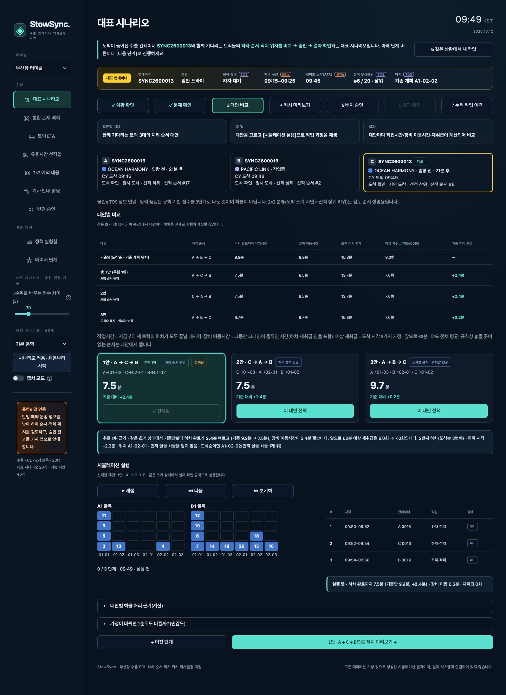
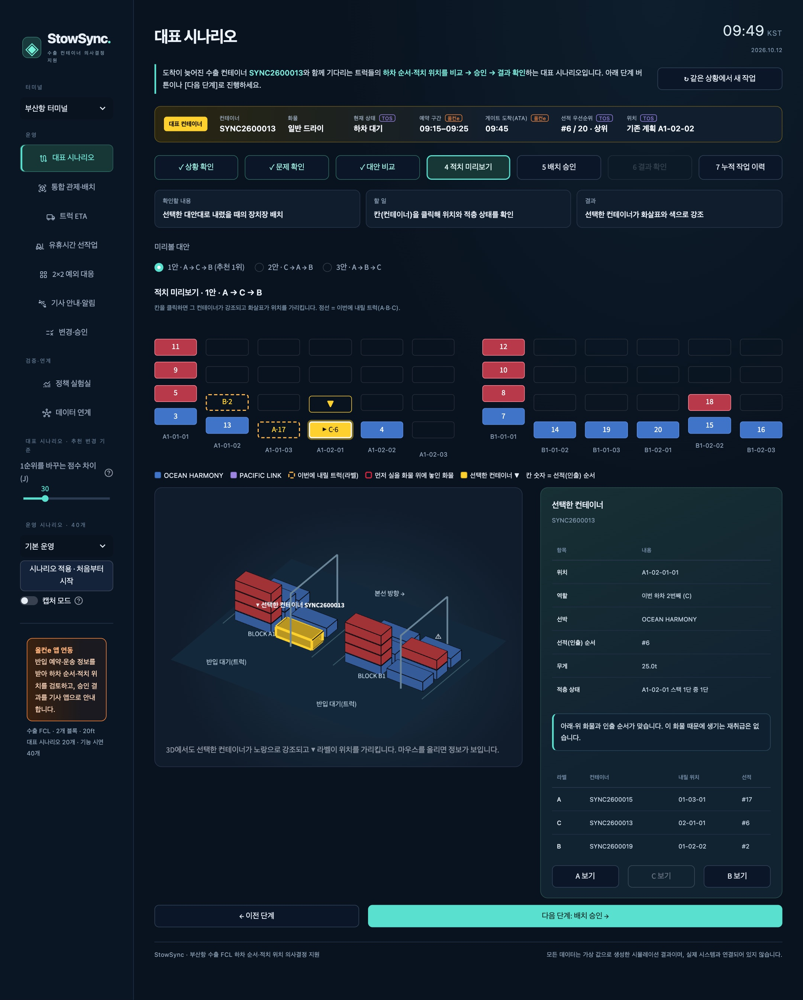
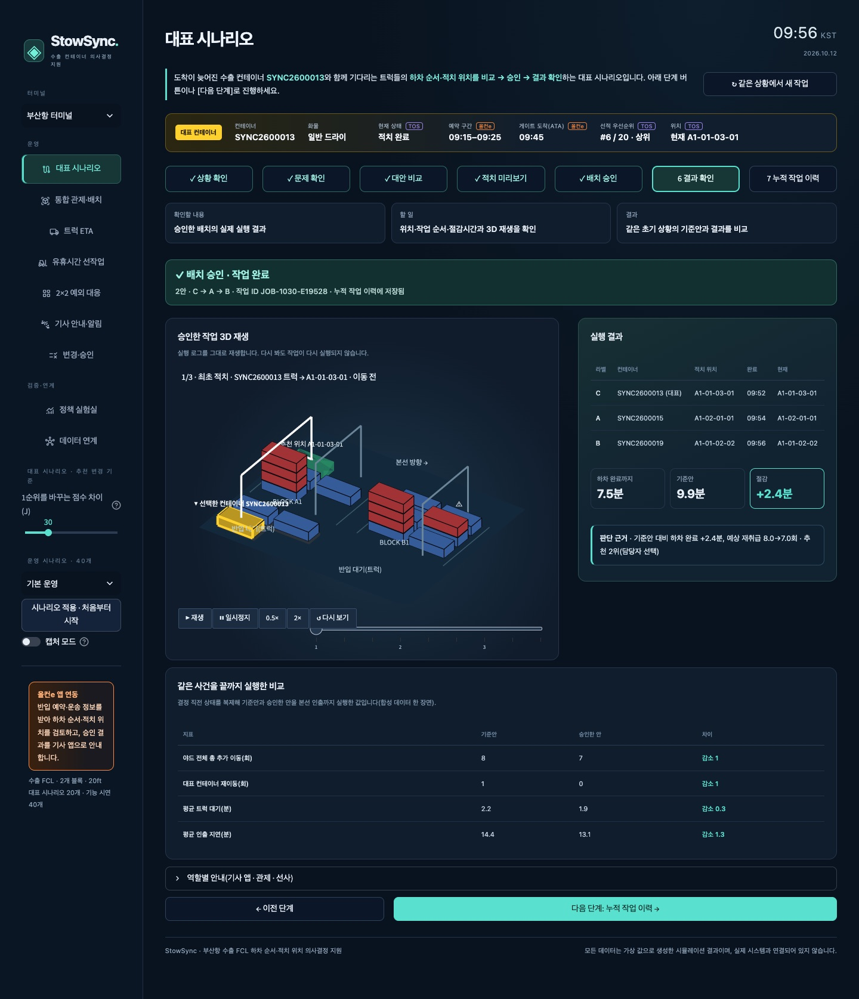
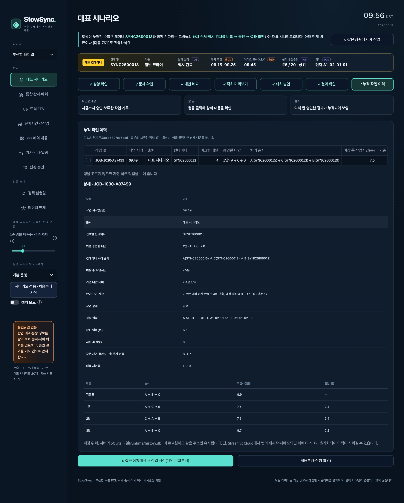

### 화면 공통 규칙

- **테마:** 어두운 남색 바탕(#09121F) + 청록(#59E0CE) 강조. **올컨e 앱**이 나오는 곳(상단 연계 띠, 출처 카드, 기사 안내, 승인 안내)은 주황 박스(#FF8A3D)로 표시해 앱 연동을 강조합니다. 실제 기관·서비스 로고는 쓰지 않습니다.
- **문구:** 기능 이름과 수치만 씁니다. 가상 데이터라는 설명은 화면 하단 한 문장으로만 표시합니다.
- **3D 색:** 파랑 = 일반 적치, 빨강 = 현재 인출 순서를 방해하는 화물(위험물 표시 아님), 노랑 + 라벨 = 선택한 대표 컨테이너, 반투명 초록 = 추천 목적 위치, 흰 화살표 = 승인된 이동 경로, 노랑 테두리 = 기존 계획 위치. 3D에 마우스를 올리면 컨테이너 번호·인출 순서·무게가 표시됩니다. 위험물은 색이 아니라 ⚠ 문자로 표시합니다. 범례는 3D 옆에 항상 표시합니다.
- **출처 표시:** 대표 시나리오에서는 정보마다 어느 시스템에서 왔는지 보여 줍니다. 주황 박스 = 올컨e 앱(반입 예약·운송 진행·기사 안내), 보라 = TOS(선박·작업계획·야드), 청록 = StowSync가 연결해 계산한 값. 실제 연계는 협의가 필요합니다.
- **도착 전 화물**은 야드에 그리지 않고 반입 대기(트럭) 영역에 그립니다. 선택한 화물은 별도 스위치 없이 자동으로 노랑 강조·▼ 라벨로 표시합니다.
- **호버·선택:** 대안 카드·장치장 칸·표 행·단계 버튼에 마우스를 올리면 배경이 은은하게 밝아지고, 선택한 항목은 테두리와 색으로 더 분명하게 강조합니다.
- **세 가지 개념을 구분합니다.** 시연 상황 = 사용자가 고른 사건, 추천 평가 = 앞으로 60분 동안 가능한 도착 상황 8가지를 가정해 후보를 비교한 예상 평균(야드 전체 기준), 작업 재생 = 실행 로그를 시간순으로 보여 주는 것. 대표 시나리오 3단계(대안 비교)의 예상값과 6단계(결과 확인)의 실행 후 값은 따로 표시합니다.
- **결과 비교 원칙:** 두 갈래는 같은 결정 직전 상태에서 나뉘고, 대표 컨테이너 외 화물은 같은 규칙(기준 정책)으로 처리합니다. 실제 도착 사건·화물·장비 조건은 같고, 미래의 실제 도착시각은 추천 입력에 쓰지 않습니다. 총 추가 이동 = 재취급 + 선작업이며 최초 적치·정상 인출은 따로 셉니다.
- **사람의 결정권:** 승인·보류는 담당자가 합니다. 관리자 선택을 채점하거나 자동 학습에 쓰지 않고, 승인·보류·사유는 중립 이력으로만 남깁니다.
- **데이터 두 벌:** 대표 시나리오는 20개 사례 전용, 나머지 기능 화면은 운영 시나리오용 40개 데이터를 씁니다. 서로 지우지 않습니다.
- **누적 작업 이력:** 대표 시나리오와 통합 관제·배치에서 승인·보류한 작업은 서버 SQLite(`runtime/history.db`)에 주소의 `?sid=` 값별로 쌓입니다. 새로고침해도 유지되지만, Streamlit Cloud에서 앱이 재시작·재배포되면 지워질 수 있습니다.
- **상태 유지:** 화면 이동·뒤로 가기는 조회만 바꿉니다. 대표 시나리오는 **↻ 같은 상황에서 새 작업**(이력은 유지), 기능 화면은 왼쪽 **시나리오 적용 · 처음부터 시작**을 누를 때만 초기화됩니다. 같은 추천은 여러 번 승인해도 한 번만 실행됩니다.

## 화면 가이드

아래는 기능별 화면 설명입니다. 캡처(docs/screenshots/guide)는 10/30 화면 개편(어두운 남색 테마, 통합 관제·배치 통합) 뒤 다시 찍었습니다. 캡처는 운영 시나리오 데이터(40개, 기본 운영)의 현재 버전 화면이며, 기능마다 찍은 시점이 달라 컨테이너·시각·수치가 서로 다를 수 있습니다. 현장 판단 학습 기능은 이번 시연 범위에서 제외했습니다.

| 살펴볼 기능 | 확인할 내용 |
|---|---|
| [01 통합 관제·배치](#dashboard) | 야드 현황, 검토 대상, 배치 대안 3개 비교·적치 미리보기, 현장 관리자 승인 |
| [02 트럭 ETA](#eta) | 예약·위치 동의·기사 이력을 반영한 도착 예측 |
| [04 2×2 예외 대응](#exceptions) | 조기·지연 × 선적 상위·하위의 배치 원칙 |
| [05 유휴시간 선작업](#premarshal) | 현재 유지와 사전 재배치의 비교 |
| [06 변경·승인](#approval) | 현장 판단 사유와 작업 시작·완료 이력 |
| [07 기사 하차 안내](#driver) | 승인 위치 안내와 기사 확인 |
| [09 변경 알림](#notifications) | 담당 역할에 따른 일정·작업 변경 공유 |
| [10 정책 실험실](#impact) | 같은 합성 사건에 대한 3개 정책 비교 |
| [11 데이터 연계](#data) | 9개 가상 터미널 일정과 변경 영향 |

<a id="dashboard"></a>

## 01. 통합 관제·배치 — 검토 대상 확인부터 배치 승인까지 한 화면에서

**메뉴: 통합 관제·배치** (예전 '통합 관제'와 'CY 배치 추천'을 합쳤습니다. `?page=recommend` 주소도 이 화면으로 연결됩니다.)

위에서부터 핵심 지표 → 검토 컨테이너 선택 → 배치 대안 3개 비교(대안별 스택 적재 순서 포함) → 적치 미리보기(3D, [적치 과정 다시 보기]로 트럭 → 들어 올림 → 내려놓기 재생) + 현장 관리자 검토(승인·보류) → 블록 적층 단면 → 우선 검토 화물·운영 이벤트 순서입니다. 검토 컨테이너 목록은 CY에 도착해 바로 승인할 수 있는 화물이 위에 옵니다.

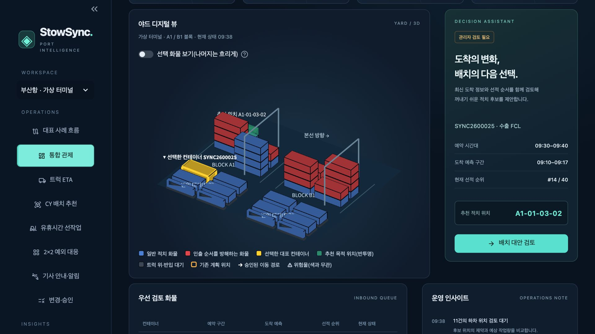

- **3D 야드:** 컨테이너의 블록·스택·높이를 공간적으로 확인합니다. 도착·인출 순서와 방해 화물 정보를 배치 검토에 활용합니다.
- **검토 대상:** 하차 대기 중인 화물을 선택해 도착 상황과 선적 관련 정보를 확인합니다.
- **배치 대안 비교:** 대안을 고르면 카드에 그 스택의 아래→위 적재 순서(#은 선적 순서)와 인출 방해 여부가 표시되고, 3D 미리보기가 그 위치로 바뀝니다. **선택한 배치 승인**을 누르면 승인이 누적 작업 이력에 저장되고 변경·승인 화면으로 이동합니다. 수치는 트럭 도착 시각을 예측 범위 안에서 8가지로 가정해 앞으로 60분을 계산한 야드 전체 평균입니다(2×2 상황 분류와 별개).

**기획서에서 보여줄 점:** 여러 화면에 흩어진 정보를 모아, 플래너가 먼저 살펴볼 작업과 판단 근거를 한 화면에서 제시합니다.

<a id="eta"></a>

## 02. 트럭 ETA — 예약 시각을 실제 도착 예상으로 구체화

**메뉴: 트럭 ETA**

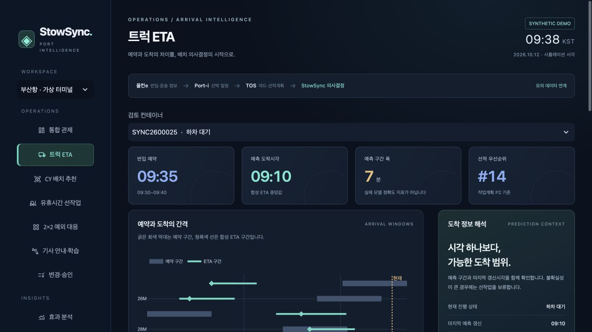

- 선택한 컨테이너의 예약 시각과 ETA, 예측 구간, 도착 편차를 확인합니다.
- 예약 정보를 기본으로 사용하고, 가상 기사 이력과 동의한 위치 입력을 더해 도착 예상을 계산합니다.
- 도착 여부를 함께 표시하며, 이미 도착한 화물의 실제 도착 상태를 새 예측으로 덮어쓰지 않습니다.

### 직접 입력을 바꿔 확인하기

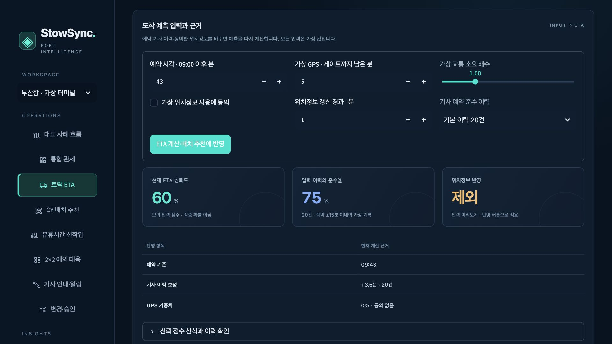

1. **운송 중인 컨테이너**를 선택합니다.
2. 예약 시각, 위치정보 동의, 잔여 이동시간, GPS 경과시간, 교통 배수, 기사 이력 조건을 바꿉니다.
3. **ETA 계산·배치 추천에 반영**을 눌러 예측 결과를 갱신합니다. 이후 배치 추천에서 이 입력을 사용합니다.

위 캡처는 위치정보 동의를 끈 예입니다. **GPS 제외 / 동의 없음**이 표시되고 예약과 기사 이력으로 계산합니다. 동의했더라도 GPS 갱신이 5분을 넘으면 위치 입력을 제외합니다.

> 화면의 **입력 품질 점수(점)**는 확률이 아닙니다. 검증된 도착 적중 확률이 아닙니다. 데모에서는 규칙 기반으로 계산하며, 실데이터 연계 후 ETA 오차와 신뢰도 보정 검증이 필요합니다.

<a id="placement"></a>

## 03. 배치 대안 비교와 승인(통합 관제·배치 화면 안)

**메뉴: 통합 관제·배치**

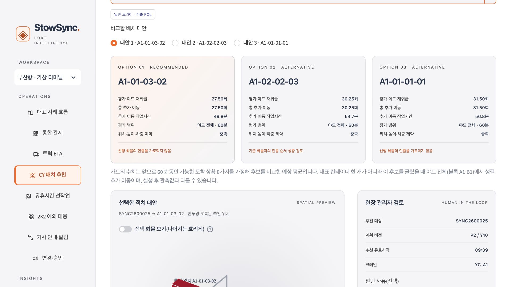

- 도착 예측, 현재 적치 상태, 인출 순서와 물리 제약을 함께 검토해 **최대 3개 후보**를 제시합니다.
- 후보마다 추천 위치, 예상 재취급, 선작업을 포함한 총 추가 이동, 작업시간과 판단 근거를 비교합니다.
- 같은 미래 시나리오를 후보별로 적용해 비교합니다. 예상 횟수는 평가 대상 야드 전체의 평균이라 소수점으로 표시될 수 있습니다.

**계산 기준:** `총 추가 이동 = 재취급 + 선작업`. 최초 적치와 본선 인출은 제외합니다. 선택한 컨테이너 한 개만의 이동 횟수가 아닙니다.

### 위치를 보고, 사유를 남기고, 결정하기

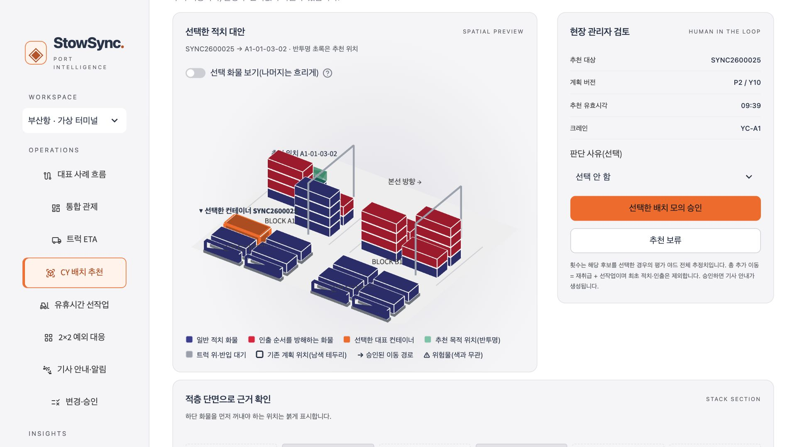

1. 후보를 선택해 **3D 야드에서 위치**를 확인합니다.
2. 추천을 따르거나 다른 대안을 선택하고, 필요하면 **판단 사유(선택)**를 남깁니다.
3. **선택한 배치 승인** 또는 보류를 선택합니다.

승인은 작업 지시를 만드는 단계입니다. 실제 시뮬레이션 적치 상태는 크레인 이동이 완료될 때 반영됩니다. 도착 상태나 크레인 가용 조건에 따라 승인 버튼이 비활성화될 수 있습니다.

### 위험물 — 별도 구역과 검토 체크

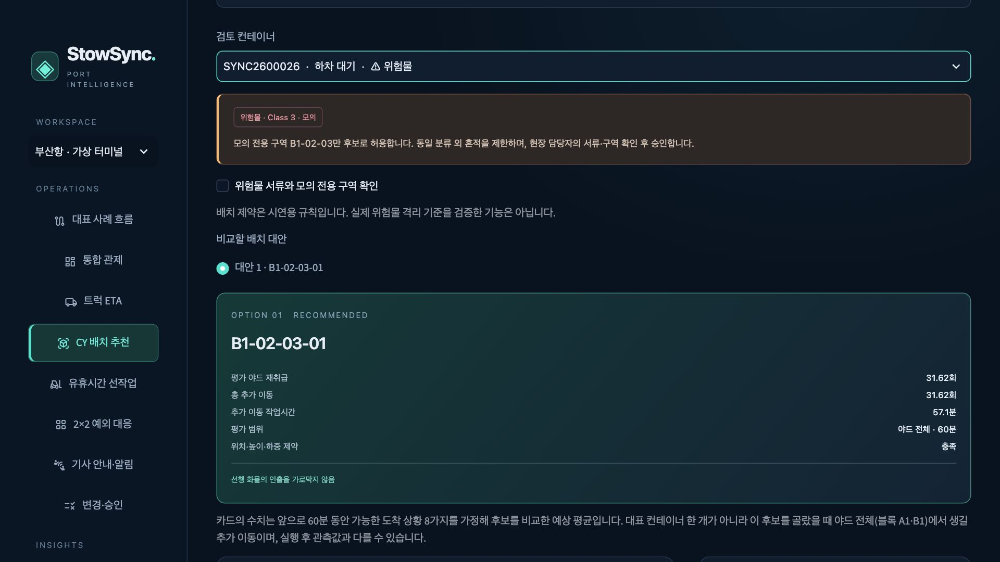

- 위험물 컨테이너를 선택하면 **화물 특성과 주의 문구**를 먼저 표시합니다.
- 모의 위험물 전용 스택과 혼적 조건을 통과한 후보만 보여 줍니다. 조건을 만족하는 자리가 적으면 후보가 1개일 수 있습니다.
- 작업자가 검토 체크를 완료해야 승인할 수 있습니다.

> 위험물 구역과 격리 조건은 단순한 데모 규칙입니다. 실제 IMDG 기준이나 터미널별 안전 규정을 구현·검증한 결과는 아닙니다.

### 환적 — 연결 선박과 선적 순서 재확인

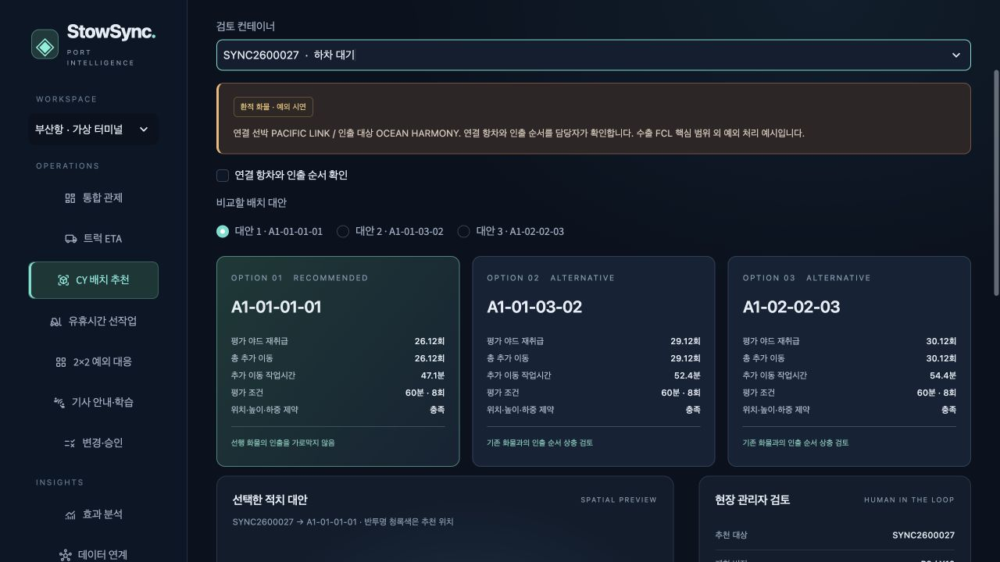

- 환적 표시와 연결 선박 정보를 강조합니다.
- 항차와 선적 순서 확인을 요구해, 일반 화물과 같은 기준으로 무심코 승인하는 상황을 줄입니다.

환적은 주 적용 대상인 **수출 FCL 직반입 외의 예외 확인 시나리오**로 포함했습니다.

<a id="exceptions"></a>

## 04. 2×2 예외 대응 — 변동 상황을 네 가지 원칙으로 설명

**메뉴: 2×2 예외 대응**

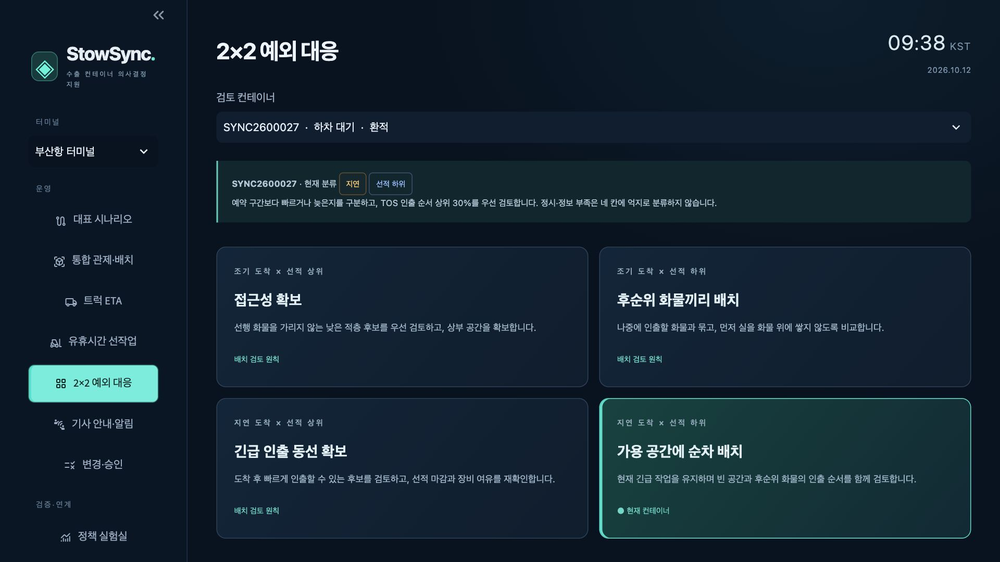

- **가로·세로 판단 축:** 도착 편차의 조기·지연과 선적 순위의 상위·하위입니다.
- 현재 컨테이너가 해당하는 칸을 강조하고, 그 상황의 배치 원칙을 보여 줍니다. 위 캡처는 **지연 도착 / 선적 하위** 예입니다.
- 후보별 예상 재취급과 지연을 함께 비교해 규칙을 실제 대안 검토로 연결합니다.

**시연:** 검토 컨테이너나 좌측 시나리오를 바꾸어 현재 분류와 후보 비교가 달라지는지 확인합니다.

데모의 선적 상위 기준은 TOS 모의 순위의 상위 30%입니다. 정상 도착이나 판단 정보가 부족한 경우는 네 칸에 억지로 분류하지 않습니다.

<a id="premarshal"></a>

## 05. 유휴시간 선작업 — 미리 옮기는 작업도 비용에 포함

**메뉴: 유휴시간 선작업**

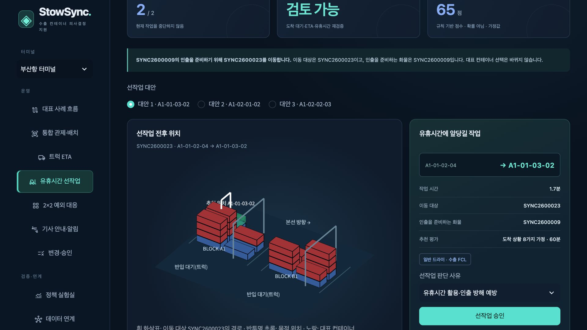

크레인이 한가한 동안 향후 인출을 방해할 컨테이너를 미리 옮기는 **Pre-marshalling**을 시연합니다.

- 크레인 가용 상태, 현재 대기 작업, 다음 작업까지의 여유시간과 ETA 품질을 확인합니다.
- 이동할 컨테이너와 **출발 위치 → 도착 위치**를 제시합니다.
- 종합 비용이 좋아져도 **총 추가 이동(재취급 + 선작업)이 현행 유지보다 늘어나는 대안은 「보류 권장」**으로 표시합니다(대안은 그대로 두고, 선택하면 경고를 띄웁니다).
- 추천 대기 상태로 처음 열어도, 현재 운영 상태를 바꾸지 않는 **미리보기 표**로 선작업 검토 장면을 보여 줍니다.
- 추천이 없을 때는 **선작업 검토 시나리오로 처음부터 시작**로 선작업을 검토할 수 있는 상태를 불러옵니다.

이 시나리오 버튼은 현재 운영 상태·기사 안내·알림·판단 이력을 초기화합니다.

### 현재 유지와 선작업의 실익 비교

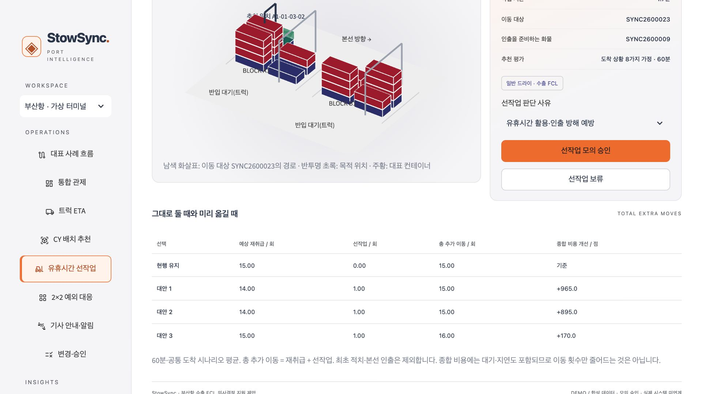

| 캡처 속 대안 | 예상 재취급 | 선작업 | 총 추가 이동 |
|---|---:|---:|---:|
| 현재 유지 | 15회 | 0회 | 15회 |
| 대안 1 | 14회 | 1회 | 15회 |
| 대안 2 | 14회 | 1회 | 15회 |
| 대안 3 | 15회 | 1회 | 16회 |

위 예에서는 대안 1의 재취급이 1회 줄어도 선작업 1회가 생겨 **총 추가 이동은 같습니다**. 이동 횟수뿐 아니라 작업 시점·예상 지연·종합 비용을 함께 보고 승인하도록 구성했습니다.

**시연:** 비교표 확인 → **선작업 승인** → **변경·승인**에서 작업 완료 확인.

ETA 품질 점수가 65 미만이거나 예측이 오래된 경우, 현재 작업과 충돌하는 경우에는 선작업을 보류합니다.

<a id="approval"></a>

## 06. 변경·승인 — 결정과 실제 작업 완료를 구분

**메뉴: 변경·승인**

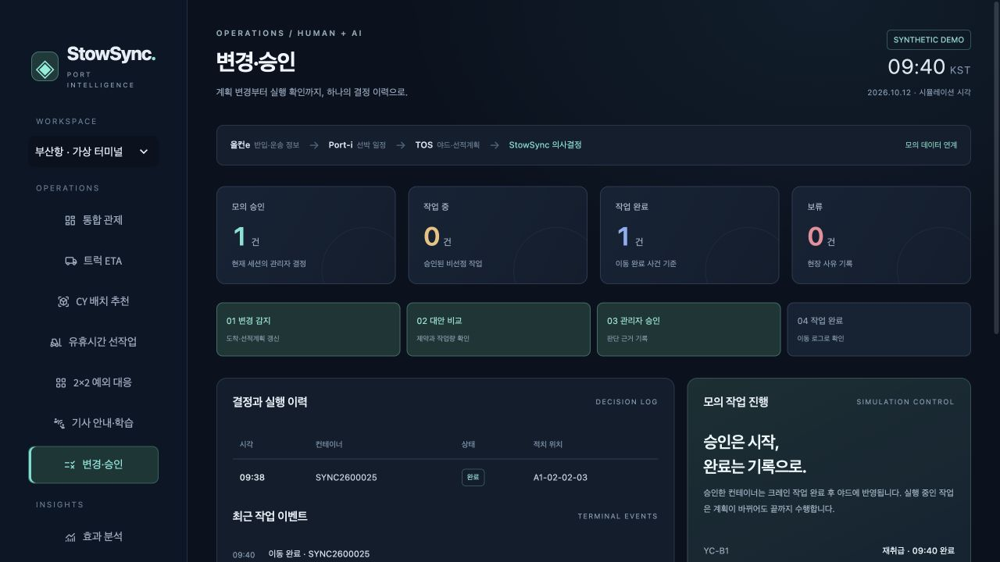

- **승인·판단 사유·작업 이력**을 통해 어떤 대안을 왜 선택했는지 확인합니다.
- 승인 건수와 작업 중·완료 상태를 구분합니다. 위 캡처는 대안 2를 선택하고 작업을 완료한 예입니다.
- **현재 작업 완료까지 진행**으로 시뮬레이션 시간을 진행해 완료 후 적치 위치를 확인합니다.
- **누적 작업 이력 보기**로 대표 시나리오의 7단계(누적 작업 이력)로 이동해 저장된 기록을 봅니다.

오래된 계획이나 중복 승인으로 같은 작업이 반복 생성되지 않도록 검사합니다. 이 기록은 기사 안내와 중립적인 작업 이력으로 이어집니다.

<a id="driver"></a>

## 07. 기사 하차 안내 — 승인된 위치를 모바일 형식으로 전달

**메뉴: 기사 안내·알림 → 기사 하차 안내 탭**

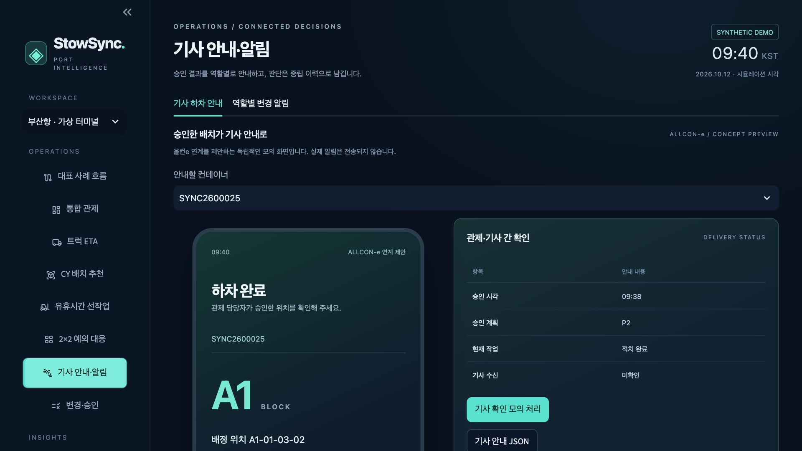

- 배치가 승인되면 컨테이너, 배정 블록·슬롯, 인계 안내와 작업 상태를 모바일 형태로 보여 줍니다.
- **기사 확인 모의 처리**를 누르면 확인 완료 상태가 표시됩니다.
- 안내 내용을 JSON으로 내려받아 승인 결과와 공유 내용의 연결을 확인할 수 있습니다.

위 캡처는 **A1-02-02-03 배정 → 기사 확인 → 하차 완료** 상태입니다. 기사는 인계 지점으로 이동하고, 야드 크레인이 스택 적치를 수행하는 흐름을 가정합니다.

> 올컨e에 실제로 발송되는 화면은 아닙니다. 승인 결과를 기사에게 어떻게 전달할지 보여 주는 연계 화면 예시입니다.

<a id="notifications"></a>

## 09. 변경 알림 — 같은 변경을 역할에 맞게 공유

**메뉴: 기사 안내·알림 → 역할별 변경 알림 탭**

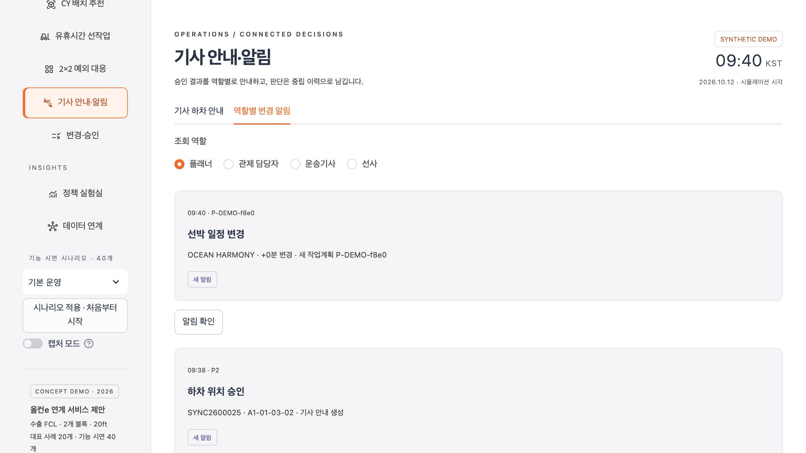

- 플래너·관제·기사·선사 역할을 선택해 관련 알림을 확인합니다.
- ETA 반영, 배치 승인, 기사 확인, 선박 일정 변경 등의 이벤트를 기록합니다.
- 일정 변경은 계획 식별자와 편차를 함께 보여 주어 어떤 계획이 바뀌었는지 추적할 수 있습니다.

**시연:** **데이터 연계**에서 선박 일정 변경 → 이 탭에서 변경 내용과 대상 역할 확인 → 알림 확인 처리.

역할 선택은 화면 미리보기 기능이며 실제 로그인 권한 관리나 외부 알림 발송 기능은 아닙니다.

<a id="impact"></a>

## 10. 정책 실험실 — 같은 조건에서 정책별 차이 확인

**메뉴: 정책 실험실**

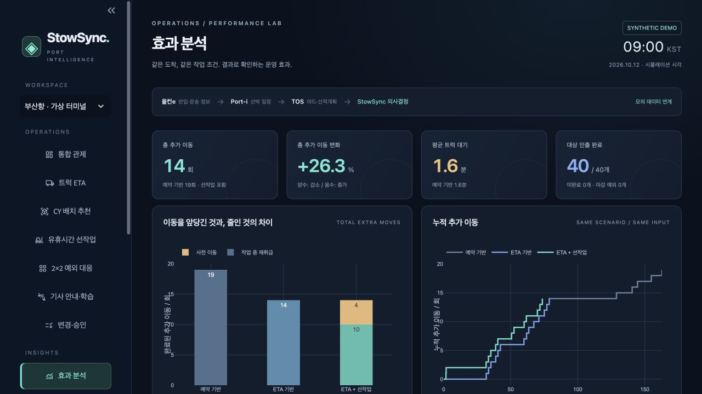

같은 합성 도착 사건과 계획 변경을 사용해 **예약 기반 / ETA 기반 / ETA + 선작업**의 세 정책을 비교합니다.

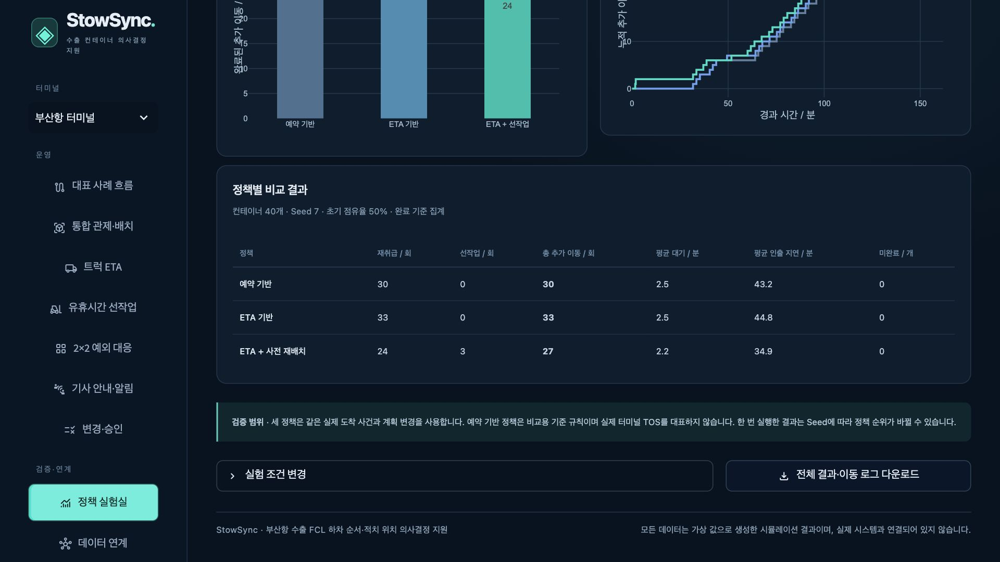

| 정책(기본 운영 · 40개 · seed 7) | 재취급 | 선작업 | 총 추가 이동 | 평균 트럭 대기 | 평균 인출 지연 |
|---|---:|---:|---:|---:|---:|
| 예약 기반 | 30회 | 0회 | 30회 | 2.5분 | 43.2분 |
| ETA 기반 | 33회 | 0회 | 33회 | 2.5분 | 44.8분 |
| ETA + 선작업 | 24회 | 3회 | 27회 | 2.2분 | 34.9분 |

이 표는 **시드 하나(7)의 한 번 실행**입니다. 같은 설정에서도 시드(합성 사건)가 바뀌면 정책 순위가 뒤집히며, ETA 기반은 이 시드에서 예약 기반보다 많았습니다. 시드 20개 × 점유율 3 × ETA 오차 3 조건의 분포는 [수치 점검 보고](docs/수치_점검_보고.md)에 있고, 화면 아래 **다조건 요약**(점유율 35·50% × ETA 오차 5·10·20분 × 시드 20개 = 120개 조건)에서도 확인할 수 있습니다. 120개 조건 평균으로 평균 트럭 대기 6.7% 감소(91개 조건), 평균 인출 지연 5.1% 감소(82개 조건), 총 추가 이동은 감소 50 · 같음 17 · 증가 53으로 일관된 감소가 없습니다. 예전 README의 '19회 → 14회'는 2026-10-13 캡처 당시 값으로, 현재 코드에서는 재현되지 않아 삭제했습니다.

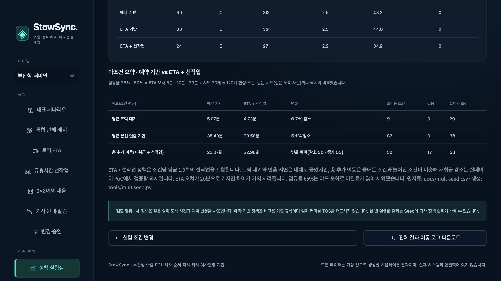

**기획서에서 보여줄 점:** 재취급만 줄었다고 성과로 판단하지 않고, 선작업을 포함한 전체 추가 이동과 지연까지 측정합니다.

> 수치는 특정 합성 시나리오의 계산 결과이며 부산항 실측 성과나 목표 달성 보장이 아닙니다. 이 자동 정책 비교는 현재 사용자가 승인하며 진행하는 수동 시연과 별도로 실행됩니다. 수동 ETA 변경·일정 변경·선호모델 적용이 기존 자동 비교 결과에 그대로 반영되는 것은 아닙니다.

<a id="data"></a>

## 11. 데이터 연계 — 어떤 정보가 어떤 판단으로 이어지는지 확인

**메뉴: 데이터 연계**

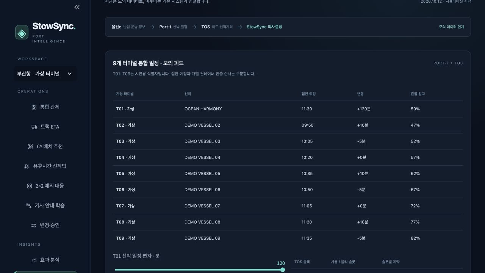

- **T01–T09의 9개 가상 터미널**로 통합 선석 일정 화면을 구성했습니다.
- 트럭 예약·위치 입력은 도착 예측으로, 선박 일정은 일정 변경 검토로, TOS 적치 상태와 선적 순서는 배치 제약으로 연결합니다.
- 터미널 단위 혼잡도는 참고 지표이며 실제 블록·슬롯의 빈자리는 TOS 모의 적치 상태로 판단합니다.

### 선박 일정 변경의 영향을 따라가기

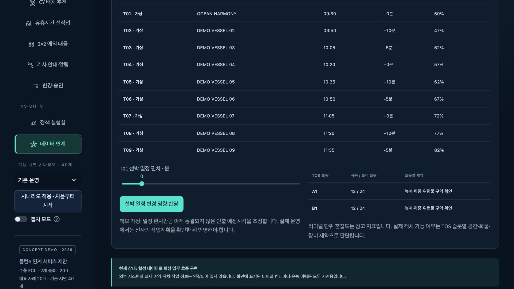

1. **T01 선박 일정 편차**를 조정합니다.
2. **선박 일정 변경·영향 반영**을 누릅니다.
3. 모의 TOS 인출 예정시각과 계획이 갱신되고 변경 알림이 생성되는지 확인합니다.

데모에서는 일정 편차만큼 아직 동결되지 않은 인출 예정시각을 이동합니다. 실행 중이거나 5분 내 예정된 작업은 유지합니다. 실제 적용에서는 터미널·선사의 최신 작업계획을 함께 확인해야 하며, **선석 일정만으로 개별 컨테이너의 선적 순서를 알 수는 없습니다.**

화면 하단에는 기존 서비스의 공개자료에서 확인한 내용과 추가 검증이 필요한 항목을 구분했습니다. 기존 예약·도착예정·장치 안내 기능과 제안 기능을 함께 검토하기 위한 자료입니다.

## 기능별 추가 시연(5분)

기능별 화면은 대표 시나리오와 별도인 **운영 시나리오 데이터(컨테이너 40개, 기본 운영)**로 열립니다. 왼쪽 **운영 시나리오 · 40개**를 바꾸면 기능 화면만 처음부터 다시 시작하고, 대표 시나리오는 그대로 유지됩니다.

1. **통합 관제·배치:** 하차 대기 화물의 대안 비교 → 다른 후보 선택과 사유 입력 → **선택한 배치 승인**.
2. **변경·승인:** **현재 작업 완료까지 진행** → 완료 상태 확인.
3. **기사 안내·알림:** 하차 안내 확인 → **기사 확인 모의 처리** → 역할별 변경 알림 확인.
4. **트럭 ETA:** 운송 중인 화물 선택 → 위치 동의나 기사 이력 변경 → **ETA 계산·배치 추천에 반영**. **2×2 예외 대응**에서 분류와 배치 원칙 확인.
5. **데이터 연계:** 선박 일정 편차 변경 → **선박 일정 변경·영향 반영** → **변경 알림** 탭 확인.
6. **유휴시간 선작업:** 필요한 경우 **선작업 검토 시나리오로 처음부터 시작** → 현재 유지와 후보 비교 → **선작업 승인** → 작업 완료 확인.
7. **정책 실험실(별도 자동 실험):** 재취급과 선작업을 합산한 총 추가 이동, 대기·지연, 미완료 건수 비교.

위험물·환적 검토는 통합 관제·배치의 컨테이너 선택에서 추가로 보여 줄 수 있습니다. 기획서 캡션에는 **“합성 데이터 기반 프로토타입”**을 표기하세요. 원본 캡처는 [화면 이미지 폴더](docs/screenshots/guide)에 있습니다.

## 로컬 실행

Python 3.12 권장.

```sh
python -m venv .venv
source .venv/bin/activate
python -m pip install -r requirements.txt
python -m streamlit run app.py
```

접속 주소: [http://127.0.0.1:8501](http://127.0.0.1:8501). 코드 변경 후에는 실행 중인 서버를 재시작하세요. 파일 감시는 꺼져 있습니다.

### Streamlit Community Cloud 배포 설정

| 항목 | 값 |
|---|---|
| 저장소 | `hgehgehge-art/stowsync` |
| 브랜치 | `main` |
| 진입점 | `app.py` |
| 권장 Python | `3.12` |

`.venv`, `runtime/`, 비밀정보는 배포 소스에 포함하지 않습니다.

## 구현·데이터 범위

| 항목 | 현재 데모 |
|---|---|
| 야드 | 2개 블록, 48개 물리 슬롯, 크레인 2대, 20ft 기준 |
| 특수 화물 | 블록별 마지막 스택을 위험물 시연 전용으로 사용, 환적 검토 예시 포함 |
| 후보 평가 | 같은 초기 상태에서 대안별 실제 실행(작업시간·장비 이동·대기) + 도착 시각 8가지 가정 · 60분 예상 재취급 |
| 선작업 보호 조건 | ETA 품질·최신성, 대기 작업, 크레인 가용 상태와 여유시간 검사 |
| 대표 시나리오 | 20개 컨테이너(초기 12 + 반입 8), 함께 기다리는 트럭 3대의 하차 순서·위치를 7단계로 비교·승인·기록 |
| 판단 이력 | 승인·보류·사유를 중립 기록으로 저장(채점·선호학습 없음), 누적 작업 이력 `runtime/history.db`, 기타 기록 `runtime/demo.sqlite3` |
| 다운로드 | 안내·판단 기록·실험 결과를 화면별 JSON 또는 CSV로 제공 |
| 실제 연계 | API 접근 권한, 실데이터, 현장 규칙과 운영 검증 필요 |

클라우드 임시 디스크는 영구 저장소가 아닙니다. 실제 운영에서는 데이터 수집 동의, 접근 권한, 영구 저장소와 감사 기록을 별도로 설계해야 합니다.

## 검증 실행

```sh
python -m pip install pytest
python -m pytest -p no:debugging tests -q
```

물리 제약·동일 사건 비교·완료 기준 집계, 승인 중복/만료, 위치정보 미동의 배제, 저신뢰 선작업 보류, 선작업 승인·완료, 위험물 제약과 검토, 2×2 분류, 계획 동결을 검증합니다. 대표 시나리오는 20개 수량, 7단계 이동·이전 단계 선택 유지, 대안 시뮬레이션 재생·초기화, 칸 클릭 선택, 승인 → 결과 확인 자동 이동 → 누적 이력 저장(2건 누적), 보류 이력, Port-i·계획 변경 대응 미노출, 도착 전 화물의 야드 미표시, 같은 결정 직전 상태에서의 두 갈래 비교, 미래 도착 미사용, 승인 중복 방지, 재생 반복 시 이동 수 불변, 화면 이동·뒤로 가기 상태 유지, 보류 분기, 목록에서 빠져도 선택 유지, 학습·채점 코드 제거를 검증합니다.
