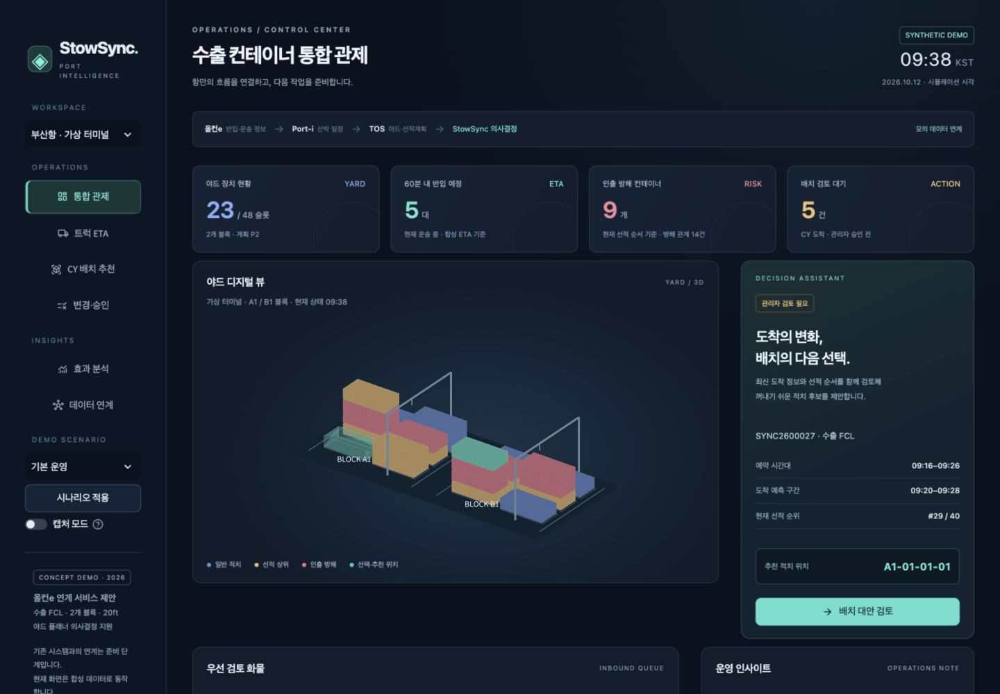
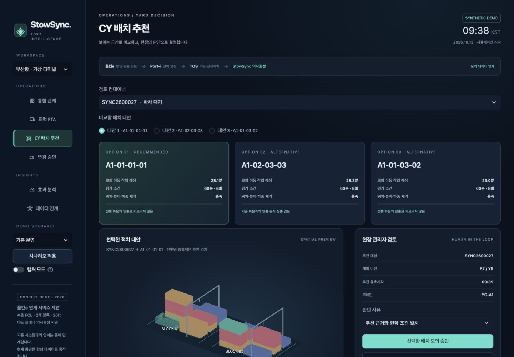

# StowSync · 수출 컨테이너 통합 관제

기획서 시연과 캡처를 위한 Streamlit 데모입니다. 올컨e·Port-i·TOS는 **모의 데이터로만 표현**되며, 실제 시스템 또는 GPS에 연결되지 않습니다.

## 실행

Python 3.12 권장. 프로젝트 폴더에서 실행합니다.

```sh
python -m venv .venv
source .venv/bin/activate
python -m pip install -r requirements.txt
python -m streamlit run app.py
```

## Streamlit Community Cloud 배포

이 폴더의 내용을 GitHub 저장소 루트에 넣습니다. `app.py`, `requirements.txt`, `.streamlit/config.toml` 및 각 Python 패키지 폴더를 함께 올립니다. `.venv`와 비밀정보는 제외합니다.

[Streamlit Community Cloud](https://share.streamlit.io/)에서 Create app을 선택하고 저장소, 브랜치, `app.py`를 지정합니다. Python 3.12를 선택합니다. 서버·데이터베이스·API 키는 필요 없습니다.

## 2분 시연

1. **통합 관제**: 도착 정보·야드 적층·검토 대기 상태를 확인합니다.
2. **배치 대안 검토**: Top 3 후보와 3D 추천 위치, 적층 단면을 확인합니다.
3. **선택한 배치 모의 승인**: 승인 이후 변경·승인 화면으로 이동합니다.
4. **현재 작업 완료까지 진행**: 작업 완료와 이동 이력을 확인합니다.
5. **효과 분석**: 동일 조건의 3개 자동 정책 결과를 비교합니다. 수동 시연 결과와 자동 비교 결과는 별도입니다.

## 기획서 캡처

좌측 캡처 모드는 조작 안내를 줄이며 합성 데이터 고지는 유지합니다. 추천 캡처는 통합 관제, CY 배치 추천, 변경·승인, 효과 분석입니다. 그림 설명에 ‘합성 데이터 기반 프로토타입’이라고 표기하세요.

## 구현과 제한

- 네이비·청록색 대시보드, 회전 가능한 3D 야드, 2D 적층 단면, ETA 구간 차트
- 모의 승인·보류·실행 완료 및 중복 승인 방지
- 2개 블록 / 48슬롯 / 20ft 일반 드라이 / 가상 크레인 2대
- 비선점 작업의 시작·완료를 처리하는 사건 시뮬레이터
- 3개 비교 정책이 같은 초기 상태, 도착 사건, 계획 변경을 사용
- 추가 이동에 선작업과 재취급을 모두 포함하며 미완료·악화도 표시
- 후보 점수는 제한된 미래 시나리오 평가이며 전역 최적해가 아님
- ETA는 생성한 예측값이며 실제로 학습한 현장 모델이 아님
- 위치·안전 제약은 시연용 단순 모델이며 실제 장비 제어에 사용 불가
- 데이터 다운로드는 합성 입력·설정·계산 로그만 포함

## 검증

```sh
python -m pip install pytest
python -m pytest tests -q
```

물리 제약, 동일 사건 비교, 추가 이동 집계, 중복·만료 승인, 전체 화면 및 승인 흐름을 검증합니다.

## 화면과 이전 버전

현재 데모는 통합 관제, 트럭 ETA, CY 배치 추천, 변경·승인, 효과 분석, 데이터 연계의 6개 화면으로 구성됩니다. VBS 기존 기능과 공개 매뉴얼의 확인 범위는 데이터 연계 화면에서 구분해 설명합니다.

기획서용 화면은 [docs/screenshots](docs/screenshots)에 있습니다. 캡처의 수치는 합성 데이터 결과입니다. 이전 구현은 [legacy/v1](legacy/v1)에 보존했습니다.




